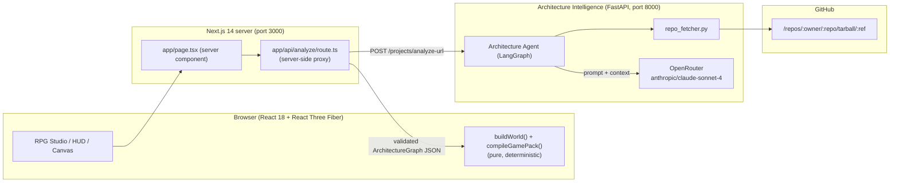
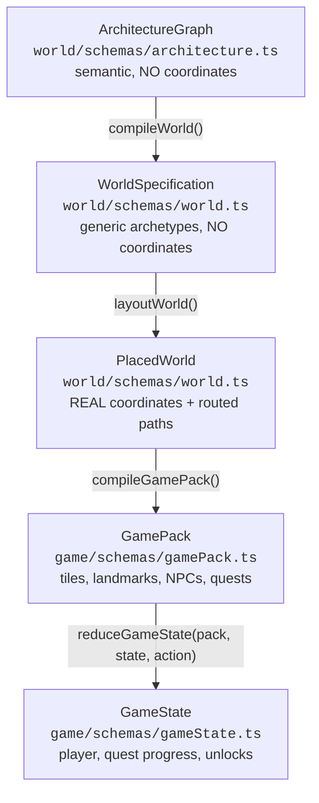
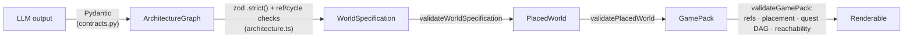

# Architecture Flow — Repository → RPG World

> **One-line mental model**
> A repository is read once by an LLM, converted into **data** (an Architecture Graph), and everything
> after that is **deterministic code** that turns that data into a 2.5D RPG world. The LLM never emits
> coordinates, never renders, and never runs.

The governing invariant, from the very first commit, is:

> **ARCHITECTURE IS DATA. WORLD IS DATA. SCENE IS CODE. RENDERING IS RUNTIME.**

Nothing downstream of the Architecture Graph may invent structure. It may only *interpret* what is there.

---

## 1. Top-level system map

Three processes run side by side:



**Who owns what**

| Concern | Owner | Why |
| --- | --- | --- |
| Repository reading | Python service | Keeps all repo/network logic out of the renderer |
| LLM prompting | Python service | Model output validated against Pydantic before it crosses the boundary |
| API key handling | Python service + Next proxy | The browser never sees the service URL or any key |
| World compilation | Browser (TypeScript) | Pure function → runs identically server/client/test |
| Rendering | Browser (R3F) | "Rendering is runtime" |

---

## 2. End-to-end flow

There are two tracks. Both converge at `buildWorld()`.

### Track A — Live repository analysis (what the user triggers)

```
1.  User pastes a GitHub URL into RepoInput (collapsed panel, bottom-left)
        │
        ▼
2.  RepoInput → POST /api/analyze  { url, branch }
        │   (Next.js route; service URL stays server-side)
        ▼
3.  route.ts → POST http://127.0.0.1:8000/projects/analyze-url   (600 s timeout)
        │
        ▼
4.  main.py → analyze_repository_url()
        │
        ├── repo_fetcher.py
        │     ├── GET /repos/{owner}/{repo}              (metadata + default branch)
        │     └── GET /repos/{owner}/{repo}/tarball/{ref} (EVERY file, one request)
        │     └── filters (SKIP_DIRS / SKIP_EXTENSIONS / PRIORITY_PATTERNS), caps size
        │
        ├── Architecture Agent (LangGraph state machine)
        │     fetch_context → extract_graph → validate_graph → (repair | finalize)
        │
        └── returns validated ArchitectureGraph (Pydantic)
        │
        ▼
5.  route.ts returns { architecture, warnings }
        │
        ▼
6.  WorldStudio.handleAnalyzed()  →  setArchitecture(graph)
        │
        ▼
7.  buildWorld(architecture)   ── pure, in the browser ──
        │   compileWorld()  → WorldSpecification
        │   layoutWorld()   → PlacedWorld
        │
        ▼
8.  RpgStudio → compileGamePack(placed)  → GamePack
        │   compileMap() + compileQuests() + validateGamePack()
        │
        ▼
9.  <RpgCanvas> renders terrain, landmarks, NPCs, player from GamePack
```

### Track B — Default / fixture world (page load)

`app/page.tsx` is a **server component**. On load it picks a fixture
(`RPA_ARCHITECTURE` or `ECOMMERCE_ARCHITECTURE`), runs `buildWorld()` on the server, and hands the
validated architecture to the client. The client then compiles the GamePack and renders the RPG. This
means the page is useful immediately with **zero** model calls and zero API keys.

---

## 3. The data pipeline (the spine of the whole system)

This is the most important diagram in the codebase. Each arrow is a schema boundary; each stage only
knows the shape on its own side.



| Stage | Produces | Carries coordinates? | Deterministic seed |
| --- | --- | --- | --- |
| `ArchitectureGraph` | groups, nodes, edges, provenance | ❌ **never** (`z.strict()` rejects x/y/z) | n/a |
| `WorldSpecification` | zones, entities, connections + visual archetypes | ❌ | derived (FNV-1a) |
| `PlacedWorld` | + `resolved_position`, routed `path` | ✅ | same seed |
| `GamePack` | tile map, landmarks, NPCs, quests, dialogue | ✅ (tile grid) | same seed |
| `GameState` | mutable session state | ✅ | n/a |

**Determinism rule:** all randomness flows through `mulberry32` in `world/compiler/random.ts`.
`Math.random()` is never used. Same architecture + same seed ⇒ byte-identical output, at every stage.

---

## 4. Layer-by-layer file map

### 4.1 Python service — `services/architecture/`

The **only** place that touches the network or an LLM. Deliberately separate from Next.js.

| File | Responsibility |
| --- | --- |
| `main.py` | FastAPI app, CORS, routes. The HTTP boundary. |
| `contracts.py` | Pydantic mirrors of the TS schemas. Includes **lenient normalisation** for advisory fields (`spatial`, `metadata`) and **strict** validation for structural fields (`type`, `group`, `parent`, edge endpoints). |
| `architecture_agent.py` | **LLM #1.** LangGraph state machine: `fetch_context → extract_graph → validate_graph → (repair│finalize)`. Holds the system prompt. One repair attempt. |
| `repo_fetcher.py` | GitHub ingestion. Exactly **2 API calls** per analysis (metadata + tarball). Filters, truncates, caps. Raises `RateLimitError` (→429) / `InvalidTokenError` (→401). |
| `provider.py` | OpenRouter provider factory. One place to swap models via env. Loads repo-root `.env`. |
| `scene_agent.py` | **LLM #2.** `build_prompt → generate_scene → validate_scene → (repair│finalize)`. Generates a TSX scene from a PlacedWorld. **Not wired into the frontend** (see §8). |
| `scene_validator.py` | Static allowlist/denylist validation of generated TSX. Rejects `eval`, `fetch`, `process`, dynamic import, etc. Never executes code. |
| `test_*.py` | pytest suites for contracts, repo fetcher, scene validator. |
| `prac.py` | **Out of scope / excluded** — do not touch. |

**HTTP surface**

| Route | Purpose |
| --- | --- |
| `GET /health` | Liveness probe (`{"status":"ok"}`) |
| `GET /github/rate-limit` | Current GitHub quota |
| `POST /projects/analyze` | Analyze from supplied context |
| `POST /projects/analyze-url` | Analyze a public GitHub URL ← **used by the app** |
| `POST /projects/scene/generate` | PlacedWorld → generated TSX |
| `POST /projects/scene/validate` | Validate TSX candidates |

### 4.2 Next.js app layer — `app/`

| File | Responsibility |
| --- | --- |
| `app/layout.tsx` | Root HTML shell. |
| `app/page.tsx` | **Server component.** Picks a fixture, runs `buildWorld()` server-side, mounts `WorldStudio`. |
| `app/api/analyze/route.ts` | Server-side proxy to the Python service. Keeps `ARCHITECTURE_SERVICE_URL` server-side, normalises errors into `{ error, retryable }`, and maps "service down" to the exact message you saw: *"Could not reach the Architecture Intelligence service at http://127.0.0.1:8000. Is it running?"* |

### 4.3 World domain — `world/` (deterministic, no React)

| File | Responsibility |
| --- | --- |
| `schemas/architecture.ts` | `ArchitectureGraph` contract. `.strict()` so coordinates can never be smuggled in. Structural validator for refs/cycles. |
| `schemas/world.ts` | `WorldSpecification` + `PlacedWorld` contracts. |
| `schemas/runtimeEvent.ts` | `RuntimeEvent` contract + `EVENT_BEHAVIOR_MAP` (event type → generic visual behaviour). |
| `schemas/validate.ts` | `validate()` / `validateOrThrow()` — zod parse + structural checks. |
| `compiler/index.ts` | **`buildWorld()`** — the single entry point. Runs the whole pipeline and throws on invalid output. |
| `compiler/worldCompiler.ts` | Architecture → World. Groups → zones, nodes → entities, edges → connections. Derives the seed. |
| `compiler/layoutEngine.ts` | World → Placed. Zone regions, root grid, child orbits, collision resolution, topology preservation. |
| `compiler/routePlanner.ts` | Positions → routed path (orthogonal streets / arcs). Endpoint validation. |
| `compiler/random.ts` | `mulberry32`, `randRange`, `round4`. The determinism source. |
| `compiler/validator.ts` | Post-layout checks (finite coords, non-degenerate paths). |
| `registries/semanticRegistry.ts` | semantic type → archetype/primitive. **Generic only** (`database → data_center`, never `redis`). |
| `registries/primitiveRegistry.ts` | Primitive footprints/heights used by layout. |
| `registries/assetRegistry.ts` | Optional GLB layer. |
| `registries/behaviorRegistry.ts` | Generic behaviour primitives. |

### 4.4 RPG game domain — `game/` (deterministic, no React)

The game layer is a **deterministic adapter**, not a rewrite. It reads `PlacedWorld` and produces a
`GamePack` — declarative data with **no executable code and no TSX**.

| File | Responsibility |
| --- | --- |
| `schemas/common.ts` | `TileCoord`, `Facing`, `GameProvenance`. |
| `schemas/tilemap.ts` | `TileMap` + **`isWalkable()`** — the single source of truth for collision. |
| `schemas/landmark.ts` | Architecture entity rendered as an RPG location. Links back via `architecture_entity_id`. |
| `schemas/npc.ts` | NPCs: role, tile, sprite, dialogue id, quest hooks. |
| `schemas/quest.ts` | Quests, objectives, prerequisites (validated as a DAG). |
| `schemas/interaction.ts` | Closed verb vocabulary (`inspect`/`talk`/`visit`/`collect`/`unlock`). **No script strings.** |
| `schemas/dialogue.ts` | Declarative dialogue trees — the seam for future LLM dialogue. |
| `schemas/theme.ts` | Theme registry contract (palette, tagline, sprite/terrain set). |
| `schemas/assetManifest.ts` | Layered asset contract. |
| `schemas/gameState.ts` | `GameState` (player, quests, unlocks, codex, dialogue, preferences). |
| `schemas/gamePack.ts` | **`GamePack`** — the boundary object. Regions + all of the above. |
| `compiler/gameCompiler.ts` | **`compileGamePack(placed, { themeId, seed })`**. Compiles, parses, validates; throws on invalid. Computes `fingerprintWorld()`. |
| `compiler/mapCompiler.ts` | Tile placement, overlap resolution, terrain grid, region bounds, entrances, A* path carving. |
| `compiler/questCompiler.ts` | `topologicalOrder()`, landmark/NPC/dialogue generation, guided quest chain. Places NPCs off entrances via `findFreeNpcTile()`. |
| `compiler/grid.ts` | A* (deterministic heap ordering), `nearestWalkable()`. |
| `compiler/validators.ts` | `validateGamePack()`: refs, placement (no shared tiles), quest DAG, flood-fill reachability. |
| `runtime/gameState.ts` | **Pure reducer** `reduceGameState(pack, state, action)` + `activeQuest`/`nextObjective`. |
| `registries/semanticWorldRegistry.ts` | NodeType → RPG archetype. Generic only. |
| `registries/themeRegistry.ts` | `arcane_kingdom`, `verdant_frontier`. |
| `registries/spriteRegistry.ts` | Sprite descriptors (procedural placeholders). |
| `registries/assetResolver.ts` | **Layered resolution:** procedural → local → external → procedural fallback. Never throws. |

### 4.5 RPG presentation — `components/rpg/`

| File | Responsibility |
| --- | --- |
| `RpgStudio.tsx` | Owns game state (reducer), UI panels, mode switching. Keyed by world fingerprint so a new repo resets state. |
| `RpgCanvas.tsx` | R3F host: orthographic camera, `dpr`, background. Thin by design. |
| `RpgWorldRenderer.tsx` | Composes terrain + landmarks + NPCs + player + camera from data. No repo branches. |
| `TileMapRenderer.tsx` | Instanced terrain (one `InstancedMesh` per terrain type). |
| `LandmarkRenderer.tsx` | One landmark; resolves archetype via registry. |
| `landmarkArchetypes.tsx` | Procedural landmark meshes (`guild_hall`, `archive`, `forge`, `portal`, …). |
| `SpriteBillboard.tsx` | Camera-facing sprite primitive (procedural placeholder). |
| `PlayerController.tsx` | Fixed-timestep movement, per-axis collision (wall sliding), facing. Emits `onMove`. |
| `RpgCameraController.tsx` | Fixed oblique camera that follows the player; snaps position to avoid jitter. |
| `interactionSystem.ts` | `findNearbyInteractable()` — pure proximity resolver. |
| `GameHud.tsx` | Quest tracker, interaction prompt, controls, mode toggles. |
| `DialoguePanel.tsx` | Renders validated dialogue nodes/choices. |
| `QuestLog.tsx` | Quest list + objective progress. |
| `CodexPanel.tsx` | Architecture meaning **and provenance** for a landmark. |
| `DeveloperDrawer.tsx` | Opt-in raw data (fingerprint, counts, full GamePack). |
| `rpgGeometry.ts` | Tile ↔ world mapping (single convention). |
| `rpgTokens.ts` | Visual tokens derived from the theme. |
| `uiStyles.ts` | Shared HUD styling. |

### 4.6 Legacy visualization — `components/visualization/`

Retained as a **developer/inspection mode** ("City View"), not the primary experience.

| File | Responsibility |
| --- | --- |
| `WorldStudio.tsx` | Top-level client component. Compiles the world, toggles **RPG ⇄ City**. |
| `WorldExplorer.tsx` | City-view shell (selection, filters, style, replay). |
| `WorldCanvas.tsx` / `WorldRenderer.tsx` | City R3F host / renderer. |
| `EntityRenderer.tsx`, `ConnectionRenderer.tsx`, `ZoneRenderer.tsx`, `CameraController.tsx`, `RuntimeEventLayer.tsx` | City rendering primitives. |
| `Inspector.tsx`, `DebugPanel.tsx`, `Toolbar.tsx`, `visualStyle.ts` | City UI + styles. |
| `RepoInput.tsx` | Repository analysis panel (collapsed by default). |

### 4.7 Scene SDK — `scene-sdk/`

The **stable contract** the Scene Agent may compose. Procedural buildings, people, vehicles,
connections, effects, behaviours. Also consumed by the city renderer.

### 4.8 Fixtures — `fixtures/`

| File | Purpose |
| --- | --- |
| `rpaArchitecture.ts` | Hand-authored RPA graph (default world). |
| `ecommerceArchitecture.ts` | Second graph for tests/proof of genericity. |
| `rpaStory.ts` | Runtime event sequence for the workflow replay. |

---

## 5. LLM usage — what model, for what

There are exactly **two** LLM call sites in the whole system. Both live in the Python service.

| # | Agent | File | Model (default) | Purpose | Input | Output |
| --- | --- | --- | --- | --- | --- | --- |
| 1 | **Architecture Agent** | `architecture_agent.py` | `anthropic/claude-sonnet-4` | Read a repository and produce the **Architecture Graph** | Repo metadata + fetched source context | Strict JSON: groups, nodes, edges |
| 2 | **Scene Agent** | `scene_agent.py` | `anthropic/claude-sonnet-4` | Turn a PlacedWorld into a **TSX scene** using only the Scene SDK | PlacedWorld + Scene SDK doc | A TSX module (statically validated) |

**Provider:** OpenRouter, via its OpenAI-compatible endpoint
(`https://openrouter.ai/api/v1`), wrapped by LangChain's `ChatOpenAI`.
**Temperature:** `0.0` for both — extraction must be as reproducible as the model allows.
**Timeout:** 300 s (`OPENROUTER_TIMEOUT`). **Retries:** 1.

### Configuration (env vars)

| Variable | Default | Effect |
| --- | --- | --- |
| `OPENROUTER_API_KEY` | — | **Required.** Throws `MissingApiKeyError` if absent. |
| `OPENROUTER_ARCHITECTURE_MODEL` | `anthropic/claude-sonnet-4` | Model for LLM #1 |
| `OPENROUTER_SCENE_MODEL` | `anthropic/claude-sonnet-4` | Model for LLM #2 |
| `OPENROUTER_BASE_URL` | `https://openrouter.ai/api/v1` | Provider endpoint |
| `OPENROUTER_TIMEOUT` | `300` | Per-call timeout (seconds) |
| `OPENROUTER_SITE_URL` / `OPENROUTER_APP_NAME` | — | Optional OpenRouter attribution headers |
| `GITHUB_TOKEN` | — | Optional; raises GitHub rate limit (60 → 5000/hr) |
| `ARCHITECTURE_SERVICE_URL` | `http://127.0.0.1:8000` | Next.js → Python service URL |

Loaded from the repository-root `.env` by `provider.py` (`load_dotenv(..., override=False)`).

### What the LLM is allowed and forbidden to do

The Architecture Agent's system prompt enforces hard rules:

1. **Never** emit `x`/`y`/`z` coordinates — spatial meaning is only `diagram_region` + `spatial` hints.
2. Use **generic** semantic types — a Redis node is `database`, never `redis` (technology names go in
   `metadata`).
3. Every `group`/`parent`/edge endpoint must reference a declared id.
4. Node ids are stable, unique, lowercase snake_case.
5. `diagram_region` must reflect real diagram geography.
6. Preserve `source` provenance where known.
7. **Output discipline:** 10–25 nodes, short metadata — this cut latency from ~200 s to ~70 s.

Malformed output is rejected by Pydantic and fed back for **one** repair attempt. If it still fails, the
run fails loudly rather than emitting a broken graph.

### The "advisory vs structural" rule (why 502s stopped)

- **Structural fields** (`type`, `group`, `parent`, edge endpoints) stay **strict** — a bad value would
  silently corrupt the world.
- **Advisory fields** (`spatial`, `metadata`, `label`, `source`, `description`) **tolerate model
  sloppiness**. Models write prose in enum fields despite instructions; `contracts.py` maps known
  synonyms and drops the rest, instead of burning a ~150 s repair round-trip.

> **The LLM does not exist in the RPG layer at all today.** All quests, dialogue, NPC placement and map
> generation are deterministic templates. `DialogueTree` is the pre-built seam for adding schema-
> constrained, architecture-grounded LLM dialogue later.

---

## 6. Validation gates

Nothing invalid reaches the renderer. Each boundary is checked:



| Gate | Checks |
| --- | --- |
| `contracts.py` | Types, refs, enum normalisation |
| `validateArchitectureGraph` | Duplicate ids, unknown group/parent, parent cycles |
| `validateWorldSpecification` | Duplicate entity ids, unknown zone/anchor, dangling edges |
| `validatePlacedWorld` | Finite coordinates, non-degenerate routes |
| `validateGamePack` | Refs, **no shared tiles**, quest cycles, **flood-fill reachability** from spawn |
| `scene_validator.py` | Allowlisted imports/components; denylist for `eval`, `fetch`, `process`, … |

---

## 7. Runtime state machine (gameplay)

The game state is a **pure reducer** — no ECS, no hidden mutation, fully unit-testable.

```
idle → moving → near-interactable → interaction-open
interaction-open → objective-progressed → quest-completed → unlock-applied
```

Actions: `move` · `interact` · `talk` · `dialogue_choice` · `close_dialogue` · `reset` ·
`set_preference`.

Invariants enforced by tests:

- A `move` onto a non-walkable tile is rejected (state unchanged).
- A dialogue choice with `next: null` **fully closes** dialogue (otherwise the world froze).
- Completing a quest's objectives activates quests whose prerequisites are now satisfied.
- `reset` is byte-identical to `createInitialGameState`.

---

## 8. Known seams and what is *not* wired yet

| Seam | Status |
| --- | --- |
| **Scene Agent (LLM #2)** | Implemented + validated in the service, **not** called by the frontend. Core gameplay deliberately does not depend on generated TSX. |
| **Runtime event replay** | `RuntimeEventLayer.tsx` animates events in the **city** view. A diegetic RPG adapter (courier sprites, conduit pulses) is planned, not built. |
| **LLM NPC dialogue** | `DialogueTree` schema exists; current content is templated. Adding LLM dialogue means filling that schema per `DialogueTreeSchema` — no renderer change. |
| **Persistence** | Planned: local-only, keyed by `world.fingerprint` + pack version. Not implemented. |
| **PDF / non-repo ingestion** | Out of scope for the first release. |

---

## 9. Running the system

Two processes are required for live analysis. The RPG world itself needs only Next.js.

```powershell
# Terminal 1 — Next.js (RPG world + proxy)
npm run dev                                  # http://localhost:3000

# Terminal 2 — Architecture Intelligence (LLM + GitHub)
Push-Location services\architecture
& "..\..\.venv\Scripts\python.exe" -m uvicorn main:app --host 127.0.0.1 --port 8000
```

Verify: `GET http://127.0.0.1:8000/health` → `{"status":"ok"}`.

```powershell
npm test                 # vitest — 76 tests
npm run typecheck        # tsc --noEmit
npx next build           # production build
python -m pytest services/architecture -q   # 55 tests
```

---

## 10. Directory overview

```
app/                      Next.js routes (page + analyze proxy)
components/rpg/           RPG studio, canvas, renderers, HUD, panels   ← primary experience
components/visualization/ Legacy technical-city view                    ← developer mode
game/schemas/             GamePack + all RPG contracts (pure data)
game/compiler/            Deterministic PlacedWorld → GamePack
game/runtime/             Pure game-state reducer
game/registries/          Semantic/theme/sprite/asset mappings (data, not branches)
world/schemas/            ArchitectureGraph, WorldSpecification, PlacedWorld, RuntimeEvent
world/compiler/           buildWorld(): compile → layout → validate
world/registries/         technical semantic/primitive/asset/behavior registries
scene-sdk/                Stable R3F primitive library (the Scene Agent contract)
fixtures/                 Hand-authored graphs + event story
services/architecture/    FastAPI + LangGraph agents + GitHub ingestion (LLM lives here)
```

---

## 11. Extension rules (for future work)

1. **Never** add a repository-, framework- or technology-specific branch to a renderer. Add a
   registry entry instead.
2. **Never** let a model emit coordinates, executable code, or TSX into the RPG runtime. Models propose
   *data* that must validate against a schema.
3. **Always** route randomness through `mulberry32`. No `Math.random()`.
4. **Always** add a validator at a new boundary rather than trusting upstream.
5. Keep the city renderer working until the RPG reaches parity on provenance and repo coverage.
6. `services/architecture/prac.py` is excluded — leave it untouched.
